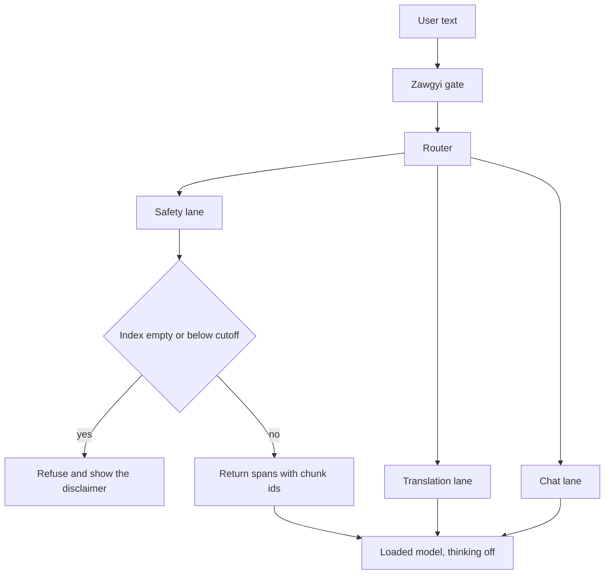

# burmeseAI

Offline Burmese and English assistant. The first artifact is a local process on the unmodified checkpoint `Qwen/Qwen3-0.6B` (Apache-2.0), with thinking turned off. Mixed-line Zawgyi text is converted before the model sees it. If safety retrieval misses, the process refuses.

This repository has no training run, no downloaded corpus, and no model weights. Scope and sources are in [docs/PLAN.md](docs/PLAN.md). Pins and the empty-cell rule are in [docs/REPRODUCIBILITY.md](docs/REPRODUCIBILITY.md).

## Problem

Burmese is a thin slice of the public web, and an English-heavy tokenizer spends many more tokens to write it.

- Arckara, [The Myanmar AI gap](https://arckara.com/research/myanmar-ai-gap), cites Common Crawl crawl `CC-MAIN-2026-34`, where Burmese (`mya`) is 0.0164% of pages ([language table](https://commoncrawl.github.io/cc-crawl-statistics/plots/languages)), and Petrov, La Malfa, Torr, and Bibi, *Language Model Tokenizers Introduce Unfairness Between Languages*, NeurIPS 2023 ([arXiv:2305.15425](https://arxiv.org/abs/2305.15425)), for a fertility of about 11.7 times English under the ChatGPT and GPT-4 tokenizer. The proceedings table lists that cell as 11.70. Those figures belong to those sources. This repository has not remeasured them.

A model that calls a remote API is down whenever the network or the power is.

- Freedom House, *Freedom on the Net 2026*, Myanmar, scores the country Not Free at 9/100. The abridged report says telecommunications infrastructure continued to sustain damage after the 2021 coup, the military kept control of major providers, and the coverage period included localized internet shutdowns plus blocking of news sites and anticensorship tools. <https://freedomhouse.org/country/myanmar/freedom-net/2026>
- DVB, dated 7 October 2026, says the Yangon and Mandalay utilities announced the rotation on Sunday to start Monday. The caption records a blackout in Yangon's Thaketa Township on 5 October. Power in those two cities is four hours on and four hours off. Ayeyarwady Region is two hours on and six hours off. The article attributes the rationing to heat and a strained grid, and it ties longer outages to the March 2025 earthquake. <https://english.dvb.no/rolling-blackouts-across-major-cities-as-heatwave-and-power-grid-collapse-intensify/>

The on-device copy has to answer from local weights and local files.

## Architecture

One process. No network socket is opened while it answers.



1. Zawgyi gate, per span. The call is `convertLine` from `github.com/arckara/zawgyi` at commit `e66860c30b616227b070ab12cb9e995dd99917fb`, under Node 20. A Burmese line with no spaces is one span. The original string stays beside the Unicode string. Whole-line threshold 0.95 is a comparison for the hand-built fixture. The product path is the span call.
2. Router, by keyword and script. Three lanes: safety (earthquake, heat, health), translation, and general chat.
3. Safety lane. Overlapping Unicode grapheme n-grams of width 3, 4, and 5. An empty index refuses. A score below the cutoff refuses. A safety fact in an answer quotes a chunk id.
4. Translation lane. The loaded model, English to Burmese or Burmese to English. No separate NLLB weights.
5. Chat lane. The first app loads unmodified `Qwen/Qwen3-0.6B`. `apply_chat_template` defaults `enable_thinking` to true. The product call passes false. A trained checkpoint replaces that file only after the plan's report labels it a success.
6. Measurements. Resident memory and tokens per second stay empty until a real process writes them.

## Quickstart

Python 3.10 or newer.

```bash
python -m venv .venv
source .venv/bin/activate
pip install -e ".[dev]"
python -c "import burmeseai"
pytest
```

`import burmeseai` loads this package and nothing under it. Zawgyi conversion, fertility, training, retrieval, evaluation, and the app are separate modules. The package import succeeds when those files are absent.

Weights and corpora stay outside git. Keep them under `data/`, `weights/`, or `artifacts/`.

## Measured results

Each cell is a label for this repository. `empty` means no run here has written a value. `smoke` means the plan's check is a fixture or a refusal path, still without a score from this repository. `target` means the plan names a success bar for a later checkpoint. A label is not a measured number.

| Check | Measured here | Label |
| --- | --- | --- |
| Fertility premium on the pinned FLORES devtest | empty | target |
| Belebele Burmese, 0-shot, thinking off | empty | target |
| FLORES devtest chrF++, both directions | empty | target |
| BURMESE-SAN | empty | target |
| GSM8K and the frozen HumanEval subset | empty | target |
| Safety retrieval | empty | smoke |
| Mixed-line Zawgyi fixture | empty | smoke |
| Resident memory and tokens per second | empty | empty |
| Apple Silicon, MLX, Android-class device | empty | empty |

The success bars themselves are written in [docs/PLAN.md](docs/PLAN.md) section 7. The first offline app does not wait on them. External figures stay in that plan as citations.

## Limitations

- The tree has no corpus and no weights. Quality, resident memory, and tokens per second stay empty until a process writes them.
- A trained checkpoint replaces the unmodified 0.6B model in the app only after the report labels that checkpoint a success. A miss is published with its measurements and stays out of the app.
- Continued pretraining of a chat checkpoint can damage chat. Inside the planned budget the countermeasure is a merge with the original chat checkpoint. English replay stays at fraction 0 until the config names a permissive source.
- The first mix may list no permissive instruction source. LoRA is skipped in that case. The merged checkpoint is still saved.
- Whole-line Zawgyi detection at 0.95 is the comparison the fixture is meant to beat. The product path is `convertLine`. A line with no spaces is one span.
- Formal and colloquial Burmese differ. The colloquial and code-switching block has no score until the file holds at least 20 human-written items, and those items stay out of training.
- Instruction data is scarce. Belebele stays eval-only: its GitHub README says the test set is CC-BY-SA 4.0, and BURMESE-SAN Table 6 lists Belebele as CC BY-NC 4.0.
- Padauk's Q8 file is a same-harness baseline when the file is local. It sits outside the laptop-class product target.
- Apple Silicon, MLX, and an Android-class device are empty rows. They are outside the first slice.
- This slice does not measure watts, and it does not set a ship date.
- Arc 1.0 is an empty harness path until a weight file exists.

## Ethics and privacy

The process is built to run with the network off. There are no accounts, no servers, and no tool that needs a network during a reply. Prompts and answers stay on the machine that runs the process. Weights, corpora, and checkpoints stay out of git.

Safety text is not a supervised training target. An answer that states a safety fact quotes a chunk id from local retrieval over earthquake, heat, and health text. An empty index refuses. A score below the cutoff refuses. The disclaimer says the pack is not emergency care. The model can be wrong about health, heat, and earthquakes, and refusal is the path when retrieval misses.

Training text has to be permissive. Non-commercial and share-alike sets stay out of the first mix. The data-mix card records the license notice from the snapshot that was downloaded, a document or token count, the synthetic count, the teacher name, the filters, and the number of native reviewers. The first card may record synthetic count 0, teacher none, and native reviewers none.

## License

Apache License 2.0. See [LICENSE](LICENSE).

The pinned Zawgyi converter is Apache-2.0 as well, and a build that vendors it keeps that notice. `Qwen/Qwen3-0.6B` is Apache-2.0.
